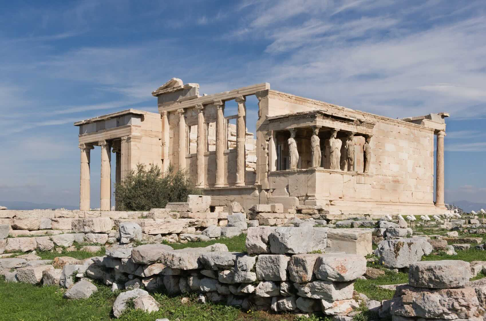
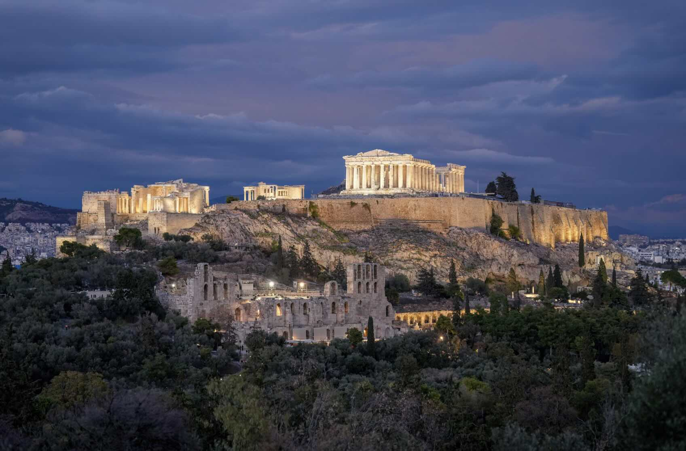
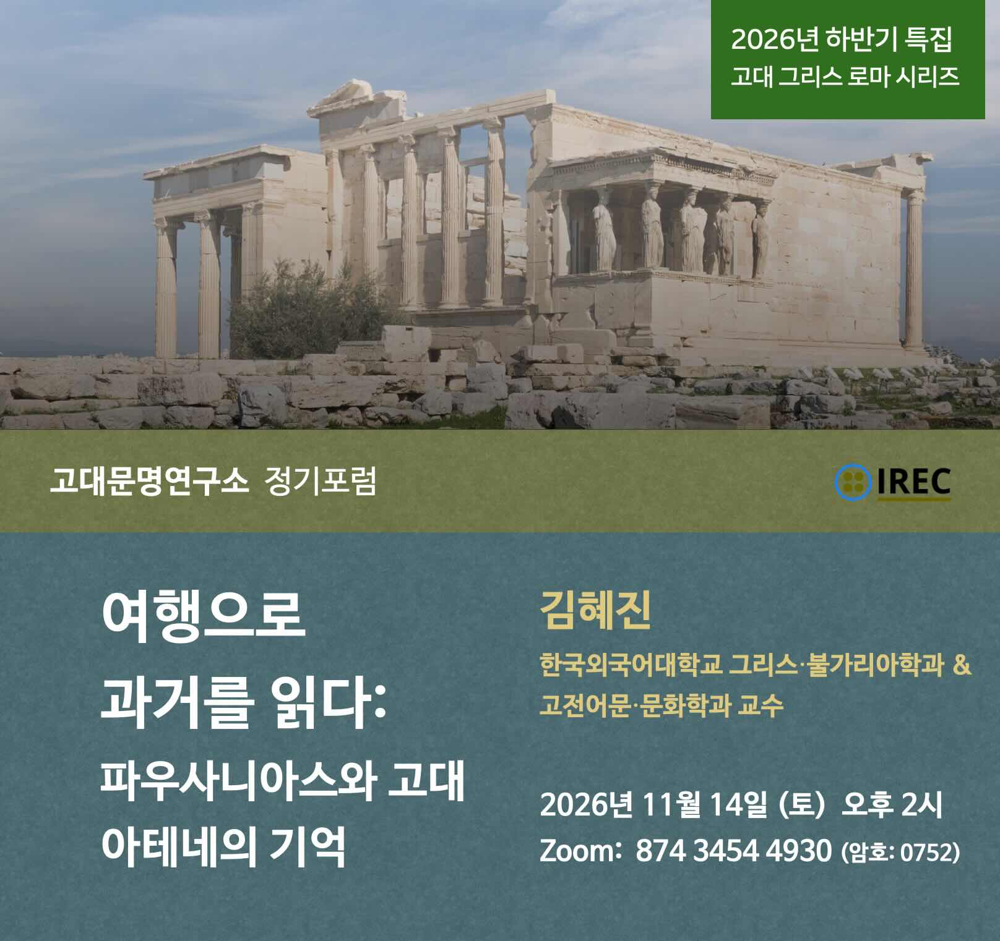
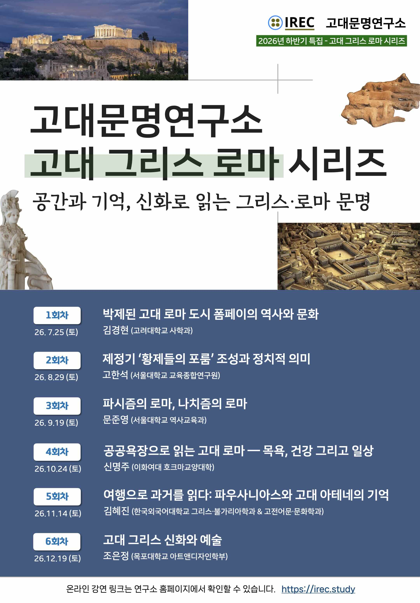

안녕하세요. 고대문명연구소 2026년 11월 정기포럼 소식을 전해드립니다.  
Zoom 을 이용해 온라인으로 진행됩니다. 관심 있는 분은 누구든 참석하실 수 있습니다.

이번 강연은 총 6회로 진행되는 고대 그리스 로마 시리즈의 다섯번째 강연입니다. 2000여 년 전 폼페이에서 출발해 로마 제정기의 공간과 기억을 살펴보고, 이어 아테네와 고대 그리스 세계로 시야를 넓혀 신화와 문화예술의 흐름을 함께 조망하고자 합니다. 많은 관심 부탁드립니다.

### 11월 정기포럼 안내

- 일시: 2026년 11월 14일 (토) 오후 2시
- 발표: __김혜진__ (한국외국어대학교 그리스·불가리아학과 & 고전어문·문화학과 교수)
- Zoom link: [https://us06web.zoom.us/j/87434544930](https://us06web.zoom.us/j/87434544930?pwd=OkAkJbqHaXIwBW6vvNDcsZ2Dl8DIGn.1)
  (회의ID: 874 3454 4930 / 암호: 0752)

### &#10092;여행으로 과거를 읽다: 파우사니아스와 고대 아테네의 기억&#10093;

서기 2세기 로마 제국의 통치 아래 놓인 그리스 본토를 20여 년에 걸쳐 직접 답사하고 기록한 파우사니아스의 『그리스 여행기(Periegesis Hellados)』는 고대 그리스의 성소와 기념물를 포함하는 문화 경관을 다룬 유일무이한 인문지리서로 평가된다. 이 강연은 『그리스 여행기』 제1권 「아티카」 편을 중심으로, 파우사니아스가 아테네의 아고라와 아크로폴리스를 여행하면서 기록한 헬레니즘 시대 통치자들의 기념물과 그 역사적 맥락을 검토하고, 나아가 고전 그리스 문화의 부흥을 추구한 '제2 소피스트 운동'이라는 서기 2세기의 사회·문화적 배경 속에서 이 저작이 지닌 의의를 소개한다. 파우사니아스의 시선을 통해 로마 제정기에 고대 아테네의 역사적 기억이 어떠한 방식으로 구성되고 전달되었는지를 살펴본다.

표지 사진: The wall (exterior) of the Herodes Atticus theatre, Acropolis, Athens, Greece.

The Erechtheum, western side, Acropolis, Athens, Greece.
 
 

 Acropolis of Athens in Greece at night, Photo by Giles Laurent
 

 

### 고대 그리스 로마 시리즈 - 강연 일정

